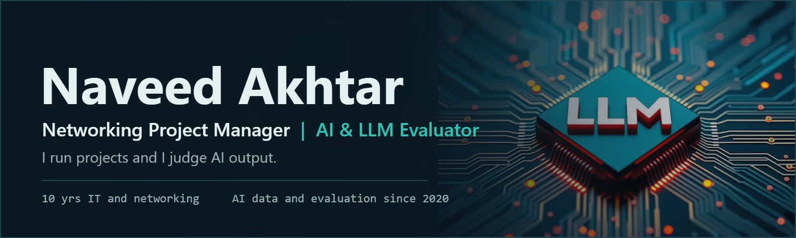
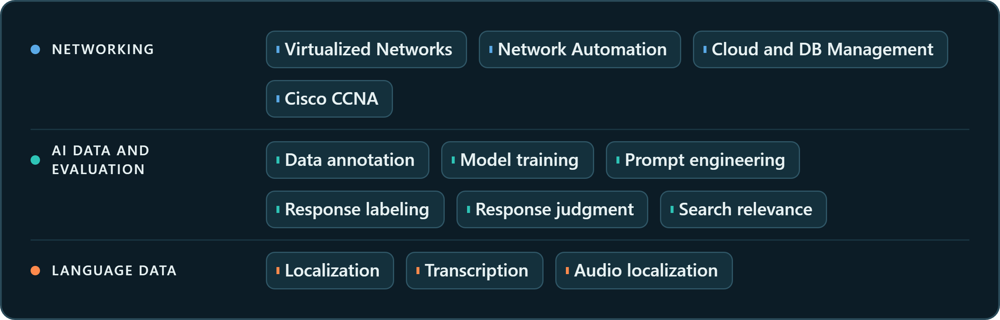

&nbsp;&nbsp;&nbsp;&nbsp;

Networking project manager with nearly ten years in IT, now working independently on AI data and LLM evaluation. Based in Malegaon, Maharashtra, India. I work remotely, to written guidelines and deadlines, in English, Hindi, Marathi and Urdu, with Tamil, Telugu and Gujarati at a professional level.

## What I do

**Project and networking work.** Directing IT and networking projects: managing people, budgets and schedules, and running project communication plans.

**AI data and training.** Machine learning data annotation, AI data quality assurance and ML data operations.

**LLM work.** Prompt creation and optimization, response labeling and judgment, and AI quality analysis against written guidelines.

**Search evaluation.** Search engine results, information retrieval and digital advertisement quality.

**Language data.** Localization, transcription and audio localization.

## About

I spent nearly ten years in IT project and networking roles at Larsen & Toubro Infotech and Infosys, planning work around business goals, deadlines, resources and team coordination. Since 2020 I have been freelancing in AI data and evaluation, where the same habits apply: read the guidelines closely, check the work, and flag gaps early.

## Education

**Bachelor of Computer Applications (BCA)**
Amity University, Mumbai (University of Mumbai). Exam May 2014, Second Class. Degree conferred at convocation on 16 August 2015.

**Cisco Certified Network Associate (CCNA)**
Cisco.

## Experience

**AI Training & Search Evaluation Specialist**, 2020 - Present
Freelance and contract work, remote.

- Annotate machine learning training data and run AI data quality assurance and ML data operations.
- Create and optimize prompts for AI and LLM training and evaluation, and review generative AI output for quality.
- Label and rank AI and LLM responses, and give clear written judgments on accuracy, relevance, tone and guideline compliance.
- Evaluate search engine results, information retrieval and digital advertisement quality against guidelines.
- Handle linguistic data work, including localization, transcription and audio localization.

**Networking Project Manager**, Jan 2014 - Mar 2020
Infosys Limited, Mumbai.

- Directed the activities of information technology projects, including managing personnel, overseeing budgets and schedules, and executing project communication plans.

**Assistant Project Manager**, Jul 2010 - Dec 2013
Larsen & Toubro Infotech.

- Provided administrative and clerical support.
- Facilitated interdepartmental communications.
- Managed schedules and maintained the digital filing system.

## Tech stack

## Core competencies

| Area | Detail |
|---|---|
| Key skills | Virtualized Networks, Network Automation, Cloud Management / DB Management, Cisco CCNA |
| Data and AI model training | Machine Learning Data Annotator, Machine Learning Training Specialist, AI Data Quality Assurance Analyst |
| AI output and prompt engineering | Prompt Engineer, LLM Optimization Specialist, Generative AI Quality Analyst |
| AI LLM work | AI LLM Prompt Creation, Response Labeling, Response Judgment, AI Quality Analyst |
| Linguistics and multimedia | Linguistic Data Specialist, Localization and Transcription Specialist, Audio Localization Specialist |
| Search algorithm quality | Search Engine Algorithm Evaluator, Information Retrieval Analyst, Digital Advertisement Quality Analyst |

## Apps

Small tools I built around my work in networking and AI evaluation. Each one runs in the browser with no sign-in.

**[IPv4 Subnet Calculator](https://naveedakhtar-88.github.io/apps/subnet.html)**
Takes an address and prefix, or an address and dotted mask, and returns the network, broadcast, wildcard, usable host range and class. Shows the network and host bits in binary and splits the block into equal smaller subnets.
`CIDR` `VLSM` `Binary view` `Vanilla JavaScript`
[Live demo](https://naveedakhtar-88.github.io/apps/subnet.html)

**[LLM Response Judge](https://naveedakhtar-88.github.io/apps/llm-judge.html)**
A side-by-side rubric for two model answers: weighted scores for accuracy, instruction following, completeness, relevance, clarity and tone, plus flags for hard problems. It checks that the overall preference agrees with the scores and counts the words in the justification.
`Rubric scoring` `Preference check` `Vanilla JavaScript`
[Live demo](https://naveedakhtar-88.github.io/apps/llm-judge.html)

**[Search Relevance Rater](https://naveedakhtar-88.github.io/apps/search-rater.html)**
Rate the results for a query from 0 to 4, then reorder them and watch DCG, NDCG and precision change against the ideal order. Built to show why ranking position matters in search quality evaluation.
`DCG` `NDCG` `Precision` `Vanilla JavaScript`
[Live demo](https://naveedakhtar-88.github.io/apps/search-rater.html)

## Languages

| Level | Languages |
|---|---|
| Native level | English, Hindi, Marathi, Urdu |
| Professional level | Tamil, Telugu, Gujarati |

---

Open to remote contract and freelance work in AI data, LLM evaluation and search quality. Email is the fastest way to reach me.

&nbsp;&nbsp;

